

  

<h1 align="center">
  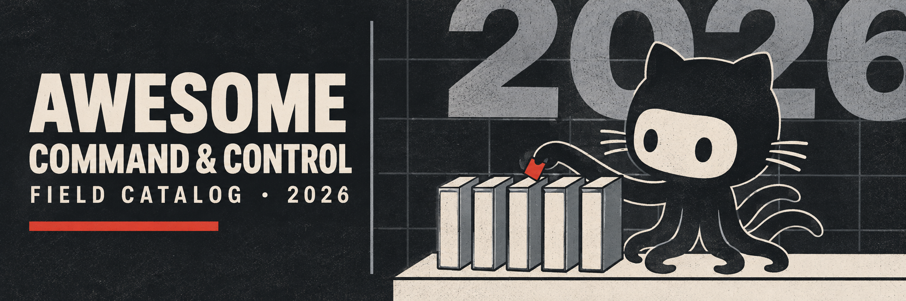
</h1>

    <h3 style="font-size: 1.7rem;" align="center">Awesome Command &amp; Control (C2) - 2026 Edition</h3>

  The best C2 tools of 2026 for red team operations. Disclaimer: this project is for security professionals doing authorized work and study.

---

# Index

- [Open Source](#open-source)
- [Commercial](#commercial)
- [Comparison](#comparison)

# Open Source

## NukeRat

NukeRat is a post-exploitation framework and C2 for advanced red team operations. The README centers on an armory of BOF and .NET utilities, implants for Windows, Linux, and macOS, and reports of commands, IOCs, and compromised hosts.

It comes with runtime evasion containing indirect syscalls, stack spoofing, and a sleep mask.

- Repository: [https://github.com/nukeratframework/nukerat](https://github.com/nukeratframework/nukerat)

- Tutorial: [https://www.youtube.com/watch?v=3dOcPoVXv30](https://www.youtube.com/watch?v=3dOcPoVXv30)

> [!NOTE]
> Click below to see more details.

More details

| | |
| --- | --- |
| Repository | [nukeratframework/nukerat](https://github.com/nukeratframework/nukerat) |
| Primary language | TypeScript, as reported by GitHub. The tree also contains a Python entrypoint, a server, a client, and implants. |
| License | GPL-3.0. The README also names MIT pieces (SGN, Nim crypt utils) and a GPLv3 LOLBAS reference copy. |
| Created | 6 November 2026 |
| Last push | 14 November 2026 |
| Stars / forks | 263 / 65 |
| Docs languages | English, Spanish, Korean, Simplified Chinese, Russian, Persian, Japanese |

[Docs](https://nukerat.com/docs) · [Armory](https://nukerat.com/docs/armory) · [Disclaimer](https://github.com/nukeratframework/nukerat/blob/main/DISCLAIMER.md). The docs home describes BOFs and .NET tools from the official repository, run from the client, plus stageless and loader builds. Repository topics also include `active-directory`, `edr-bypass`, and `lateral-movement`. Those three stay topics. The feature table gives them no row, so they are not categories.

| Category | In the project's words | Source |
| --- | --- | --- |
| Armory | More than 550 adapted BOF and .NET utilities. | `README` |
| External-platform C2 | Custom C2 with external platforms. The examples named are Telegram and Discord. | `README` |
| Runtime evasion | A feature row under that name. | `README` |
| Injections | A feature row for allocation modes. | `README` |
| Living off the land | Integration with more than 240 native Windows binaries, cited as LOLBAS. | `README` |
| Static evasion | A feature row for PE customization. | `README` |
| Implants | Cross-platform: Windows, Linux, and macOS, with ARM support. | `README` |
| Linux BOF | Linux implants described as compatible with Linux BOFs. | `README` |
| AI | Integration with agents. The examples named are DeepSeek and local agents. | `README` |
| Reports | Executed commands, IOCs, and compromised hosts. | `README` |
| Client | The docs say the armory tools are ready to run from the client. The README includes a gallery. | `Docs` |

 

  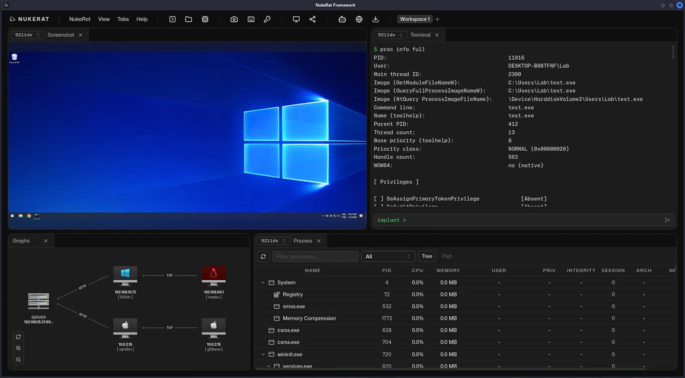

## Sliver

Sliver is Bishop Fox's framework for adversary emulation and authorized red team work. The server and client run on Windows, Linux, and macOS, and the implants officially support those same three, with C2 over mutual TLS, WireGuard, HTTP(S), and DNS.

- Repository: [https://github.com/BishopFox/sliver](https://github.com/BishopFox/sliver)

> [!NOTE]
> Click below to see more details.

More details

| | |
| --- | --- |
| Primary language | Go |
| License | GPL-3.0 |
| Last push | 14 November 2026 |
| Stars / forks | 12,337 / 1,674 |

The README says implants are dynamically compiled with unique per-binary asymmetric encryption keys, and that they support native and shellcode payloads, userspace reflective loading, built-in shellcode encoding, and BOF/COFF execution on amd64 and arm64.

| Category | In the project's words | Source |
| --- | --- | --- |
| Transports | Mutual TLS, WireGuard, HTTP(S), and DNS. | `README` |
| Implants | Windows, Linux, and macOS. BOF/COFF on amd64 and arm64 for those three. | `README` |
| Per-build keys | Unique per-binary asymmetric encryption keys. | `README` |
| Payload forms | Native and shellcode payloads, userspace reflective loading, built-in shellcode encoding. | `README` |
| Armory | The Armory page describes a package manager for aliases and extensions, including BOFs and .NET tooling. The armory index lists 22 aliases and 157 extensions. Aliases wrap .NET assemblies or shared libraries. Extensions are BOFs or native libraries. Packages install on the client and are not shared across operators in multiplayer. Signed packages come from the Sliver Armory GitHub organization. | `Docs` |
| AI store | The same Armory page describes a separate server-side store for an AI agent, distinct from the client Armory. | `Docs` |
| Adversary emulation | The README's own name for the project. | `README` |

 

  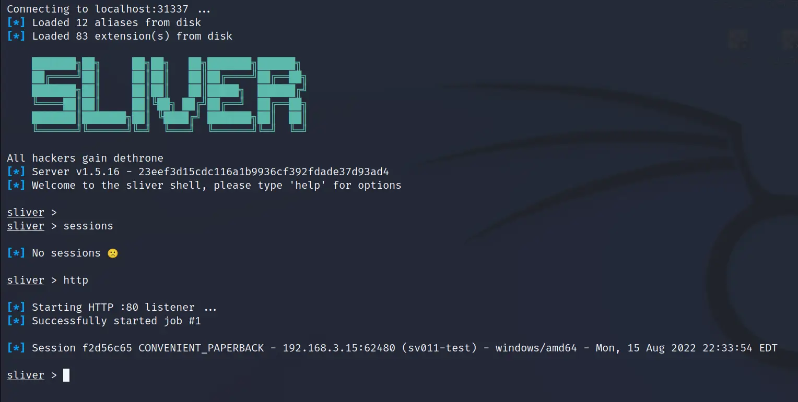

## Havoc

Havoc is a malleable post-exploitation command-and-control framework by @C5pider. The client is a cross-platform Qt UI, the teamserver is Go, and the flagship agent is Demon, written in C and assembly. GitHub marks the repository archived.

- Repository: [https://github.com/HavocFramework/Havoc](https://github.com/HavocFramework/Havoc)

> [!NOTE]
> Click below to see more details.

More details

Site: [havocframework.com](https://havocframework.com). Wiki: [Havoc wiki](https://github.com/HavocFramework/Havoc/wiki).

| | |
| --- | --- |
| Primary language | Go |
| License | GPL-3.0 |
| Last push | 18 December 2025 |
| Stars / forks | 8,501 / 1,272 |
| Repository state | Archived, in the GitHub API. |

The teamserver is described as multiplayer, with payload generation, HTTP/HTTPS listeners, customizable C2 profiles, and External C2. Demon's README section lists SMB support, a token vault, and built-in post-exploitation commands, and it also lists sleep obfuscation, x64 return-address spoofing, indirect syscalls, and AMSI/ETW patching via hardware breakpoints.

The same README states that Havoc was not developed to be evasive. It was designed to be malleable and modular, so an operator can add custom features or modules. That sentence decides the category. Evasion is not one of them.

| Category | In the project's words | Source |
| --- | --- | --- |
| Malleable C2 | The project's own adjective, plus customizable C2 profiles. | `README` |
| Multiplayer | A multiplayer teamserver. | `README` |
| GUI | Cross-platform Qt client. | `README` |
| Listeners | HTTP/HTTPS listeners. Demon also lists SMB support. | `README` |
| External C2 | An External C2 section, with a wiki link. | `README` |
| Demon | The flagship agent, C and assembly. | `README` |
| Modules | A modules repository, a Python API, and custom agent support. Talon is the custom agent the README names. The modules repository names BOF sets and InvokeAssembly. | `README` |
| Payloads | The teamserver lists payload generation for exe, shellcode, and dll. The wiki says only x64 EXE and DLL formats are supported. | `README` |

 

  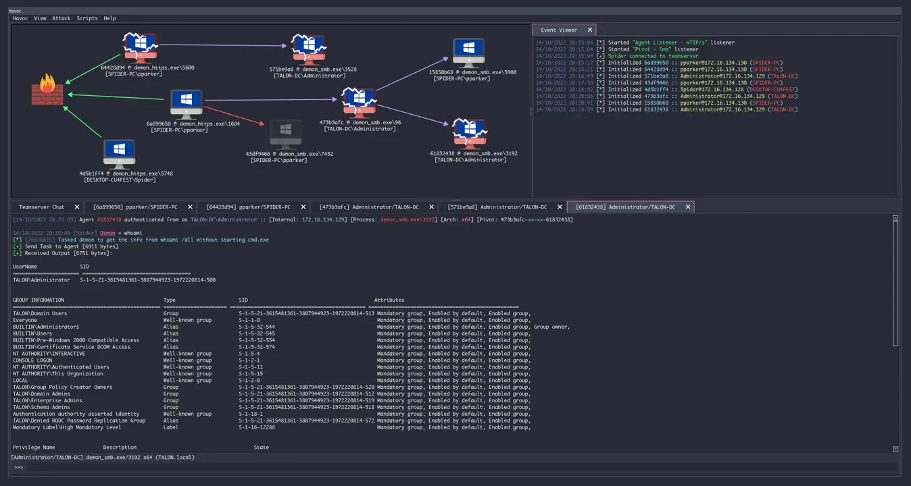

## Mythic

Mythic is a collaborative post-exploit framework. Operators, managers, and reporting share one browser UI. The core repository is the server and the interface. Agents and C2 profiles are installed from other repositories.

- Repository: [https://github.com/its-a-feature/Mythic](https://github.com/its-a-feature/Mythic)

> [!NOTE]
> Click below to see more details.

More details

Docs: [docs.mythic-c2.net](https://docs.mythic-c2.net). The README names Go, Docker, docker-compose, and a browser UI. Agent and profile index: [mythicmeta.github.io/overview](https://mythicmeta.github.io/overview).

| | |
| --- | --- |
| Primary language | JavaScript, as reported by GitHub. The README leads with Go, Docker, and the browser UI. |
| License | The `LICENSE` file opens with a BSD 3-Clause grant, copyright 2018 Cody Thomas. The same file embeds other licenses, and the GitHub API reports `NOASSERTION`. |
| Last push | 14 November 2026 |
| Stars / forks | 4,911 / 630 |

The core repository does not host payload types or C2 profiles. Both are installed from other repositories. The README points at the MythicMeta overview for the catalog, and at MythicMeta packages for scripting and for the container glue around RabbitMQ.

| Category | In the project's words | Source |
| --- | --- | --- |
| Collaboration | A collaborative interface for operators, managers, and reporting. | `README` |
| Web UI | A browser UI. | `README` |
| Pluggable agents | Payload types live outside the core repo and are installed into a running instance. | `README` |
| Pluggable C2 profiles | C2 profiles are installed the same way, from their own repositories. | `README` |
| Docker services | Docker and docker-compose for the components. Container images are published under `itsafeaturemythic`. | `README` |
| Scripting | A Mythic scripting repository is linked from the README. | `README` |
| Reporting | Named alongside operators and managers as something the interface is for. | `README` |

 

  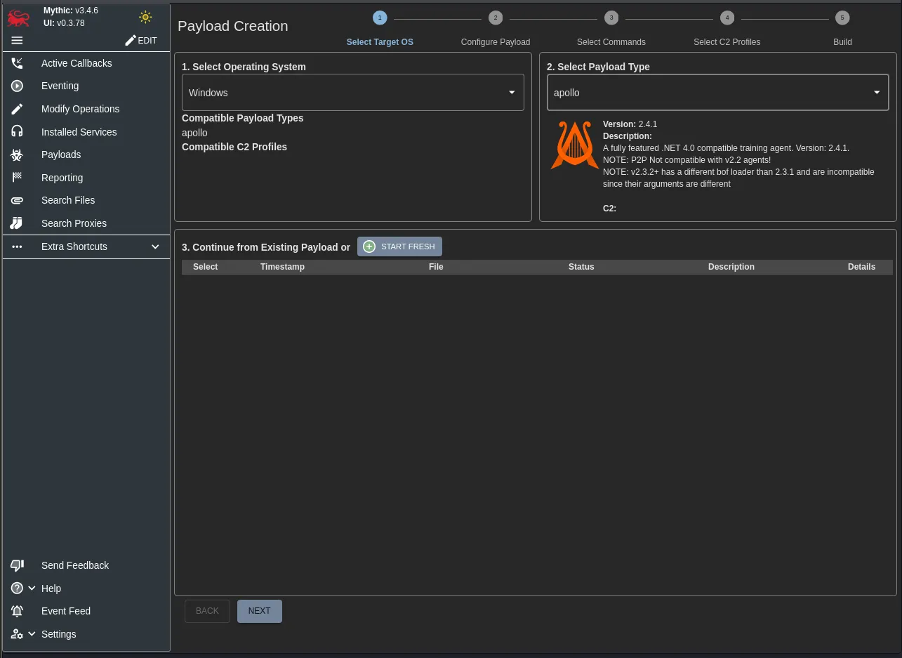

## AdaptixC2

AdaptixC2 v1.2 is an extensible post-exploitation and adversarial emulation framework for authorized testing. The server is written in Go. The client is a Qt GUI for Windows, Linux, and macOS, and both listeners and agents are plugins.

- Repository: [https://github.com/Adaptix-Framework/AdaptixC2](https://github.com/Adaptix-Framework/AdaptixC2)

> [!NOTE]
> Click below to see more details.

More details

Docs: [Adaptix gitbook](https://adaptix-framework.gitbook.io/adaptix-framework). Extension kit: [Adaptix-Framework/Extension-Kit](https://github.com/Adaptix-Framework/Extension-Kit).

| | |
| --- | --- |
| Primary language | C++, as reported by GitHub. |
| License | GPL-3.0 |
| Last push | 1 November 2026 |
| Stars / forks | 3,886 / 709 |

| Category | In the project's words | Source |
| --- | --- | --- |
| Multiplayer | Server/client architecture for multiplayer. | `README` |
| GUI | Cross-platform Qt client. | `README` |
| Encrypted channels | Fully encrypted communications. | `README` |
| Extenders | Listeners and agents are plugins. | `README` |
| Extension kit | A separate official Extension-Kit repository. Its README lists 10 BOF groups. Execution-BOF includes in-process .NET assembly execution. | `README` |
| Scripting | AxScript engine. | `README` |
| Operator data | Task and job storage, a credentials manager, and a targets manager. | `README` |
| BOF | BOF and async BOF support. | `README` |
| Pivoting | SOCKS4, SOCKS5, SOCKS5 with auth, and local and reverse port forwarding. | `README` |
| Session graph | Linking agents, plus a session graph. | `README` |
| Agent lifetime | Health checker, kill date, and working-time control. | `README` |
| Implants | Windows, Linux, and macOS agents. | `README` |
| Listeners shipped | HTTP/S, DNS/DoH, SMB, and TCP beacon listeners, plus a TCP/mTLS Gopher listener. Agents named in the same list: Beacon and Gopher. | `README` |

 

  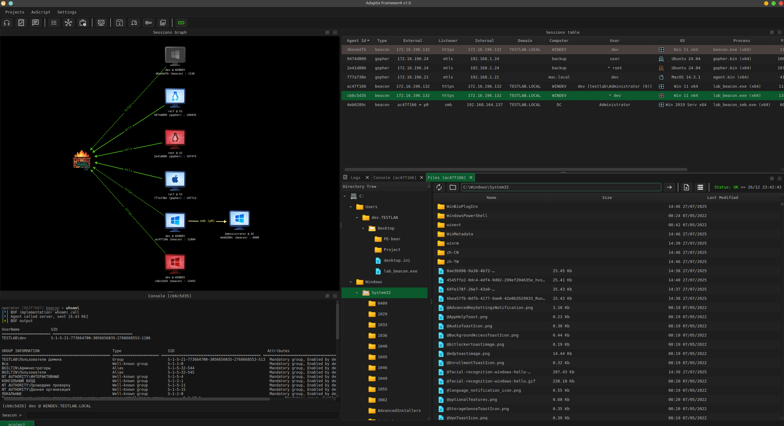

## Empire

Empire is BC Security's post-exploitation and adversary emulation framework for red teams and penetration testers. The server is Python 3, a remote client ships with it, and Starkiller is the web GUI. As of version 5.0, Starkiller is packaged with Empire.

- Repository: [https://github.com/BC-SECURITY/Empire](https://github.com/BC-SECURITY/Empire)

> [!NOTE]
> Click below to see more details.

More details

Wiki: [bc-security.gitbook.io/empire-wiki](https://bc-security.gitbook.io/empire-wiki/). Starkiller: [BC-SECURITY/Starkiller](https://github.com/BC-SECURITY/Starkiller). The original [EmpireProject/Empire](https://github.com/EmpireProject/Empire) repository is archived. Its last push in the API is 19 January 2020. This entry is the BC Security repository.

| | |
| --- | --- |
| Primary language | PowerShell, as reported by GitHub. The README says the server is Python 3. |
| License | BSD 3-Clause |
| Last push | 8 September 2026 |
| Stars / forks | 5,353 / 707 |

| Category | In the project's words | Source |
| --- | --- | --- |
| Multiplayer | Server/client architecture for multiplayer. | `README` |
| GUI | Starkiller, a web GUI that talks to the Empire API. | `README` |
| Listeners | HTTP/S, malleable HTTP, foreign, hop, SMB, and port-forward pivot listeners. | `README` |
| Encrypted channels | Fully encrypted communications. | `README` |
| Module library | A library the README counts at more than 400 tools, in PowerShell, C#, and Python. | `README` |
| Agents | PowerShell, Python 3, C#, IronPython 3, and Go. | `README` |
| In-memory .NET | In-memory .NET assembly execution. | `README` |
| BOF | BOF execution is one of the module groups the README links. | `README` |
| Obfuscation | Integrated obfuscation via ConfuserEx 2 and Invoke-Obfuscation. | `README` |
| Bypasses | A feature line named "Customizable Bypasses". | `README` |
| Traffic evasion | A feature line named "JA3/S and JARM Evasion". | `README` |
| ATT&CK | MITRE ATT&CK integration. | `README` |
| Plugins | A modular plugin interface for server features, and a module interface for new tools. | `README` |

 

  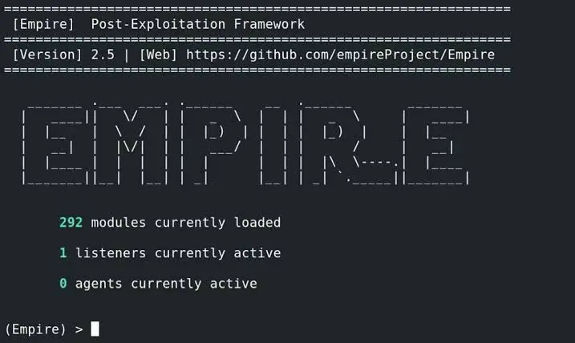

## Merlin

Merlin is a cross-platform post-exploitation command-and-control server and agent written in Go. The CLI connects over gRPC for more than one operator. The README names HTTP/1.1, HTTP/2, and HTTP/3, plus peer-to-peer over SMB, TCP, and UDP.

- Repository: [https://github.com/Ne0nd0g/merlin](https://github.com/Ne0nd0g/merlin)

> [!NOTE]
> Click below to see more details.

More details

Docs: [merlin-c2.readthedocs.io](https://merlin-c2.readthedocs.io/en/latest/). The agent source, CLI, and a Mythic port live in sibling repositories linked from the README.

| | |
| --- | --- |
| Primary language | Go |
| License | GPL-3.0 |
| Last push | 15 October 2026 |
| Stars / forks | 5,635 / 833 |

| Category | In the project's words | Source |
| --- | --- | --- |
| Multi-user CLI | `merlin-cli` over gRPC, described as facilitating multi-user support. | `README` |
| HTTP family | Agent protocols named: HTTP/1.1 cleartext, HTTP/1.1 over TLS, HTTP/2, HTTP/2 cleartext (h2c), and HTTP/3 (HTTP/2 over QUIC). | `README` |
| Peer-to-peer | Bind or reverse peer-to-peer for SMB, TCP, and UDP. | `README` |
| Message transforms | Configurable encoding and encryption transforms. The names listed are AES, Base64, gob, hex, JWE, RC4, and XOR. | `README` |
| Authenticators | Configurable agent authenticators. The names listed are none, and OPAQUE. | `README` |
| Message auth | Encrypted JWT for message authentication. | `README` |
| Traffic appearance | Configurable message padding, described as a way to deal with detections that key on a fixed message size. A separate line covers dynamically changing the agent's JA3 hash. | `README` |
| Mythic agent | The README says Merlin can be used as a Mythic agent and links [MythicAgents/merlin](https://github.com/MythicAgents/merlin). | `README` |
| Modules | The README links a module menu in the docs. It does not describe a package catalog under the name Armory. | `README` |

 

  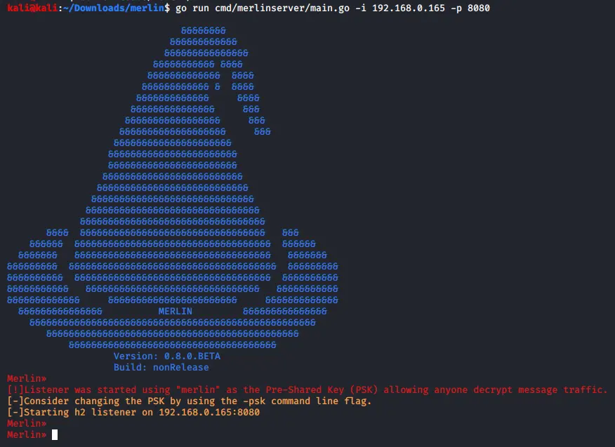

## Caldera

Caldera is Apache's platform for adversary emulation, manual red teams, and incident response. It is built on MITRE ATT&CK. The core repository includes an asynchronous command-and-control server with a REST API and a web interface. Plugins in other repositories add agents, reporting, and collections of techniques.

- Repository: [https://github.com/apache/caldera](https://github.com/apache/caldera)

> [!NOTE]
> Click below to see more details.

More details

Home: [caldera.apache.org](https://caldera.apache.org/). Docs: [caldera.readthedocs.io](https://caldera.readthedocs.io/en/latest/). The old `mitre/caldera` path now resolves to `apache/caldera`.

| | |
| --- | --- |
| Primary language | Python |
| License | Apache-2.0 |
| Last push | 12 October 2026 |
| Stars / forks | 7,531 / 1,416 |

| Category | In the project's words | Source |
| --- | --- | --- |
| C2 server | An asynchronous command-and-control server with a REST API. | `README` |
| Web UI | A web interface. Current UI work points at the Magma plugin. | `README` |
| Adversary emulation | The first purpose named in the README, on top of ATT&CK. | `README` |
| Plugin agents | Sandcat is the default agent plugin. Manx is the shell and reverse-shell plugin. Builder dynamically compiles payloads. | `README` |
| TTP libraries | Stockpile is the technique and profile storehouse. Atomic wraps Atomic Red Team. Emu wraps CTID emulation plans. | `README` |
| Reporting | Debrief is described as operations insights. | `README` |
| Incident response | A stated purpose of the platform, with a Response plugin. | `README` |
| Visualization | Compass for ATT&CK visualizations, and GameBoard for joint red and blue operations. | `README` |

 

  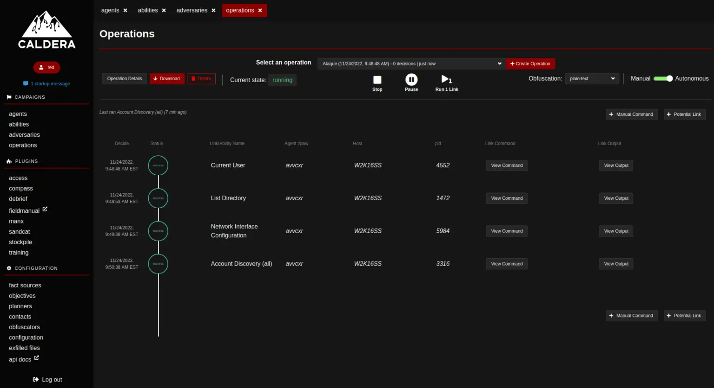

---

# Commercial

## Cobalt Strike

Cobalt Strike is Fortra's software for adversary simulations and red team operations. The homepage describes a post-exploitation agent, covert channels, malleable C2, collaboration, and reports meant to aid blue-team training. The latest-release line on that page is 4.13.

> [!NOTE]
> Click below to see more details.

More details

Homepage: [cobaltstrike.com](https://www.cobaltstrike.com/). Fortra's product line repeats the same framing: [fortra.com/product-lines/cobalt-strike](https://www.fortra.com/product-lines/cobalt-strike). The 4.13 line names Beacon Interpreter, BOF-PE support, LLVM Beacon, Payload Store, Malleable Profile Overrides, a docking GUI, and streaming support. The same page says the product interoperates with Core Impact and Outflank Security Tooling. Raphael Mudge created it in 2012. Fortra acquired it in 2020. The features pages name an Arsenal Kit and a Sleep Mask Kit. A Cobalt Strike blog says Beacon is a Windows-only payload.

| Category | In the project's words | Source |
| --- | --- | --- |
| Adversary simulation | The homepage title and the opening description. | `Site` |
| Post-exploitation agent | Named directly, with covert channels. | `Site` |
| Malleable C2 | Change network indicators to look like different malware. The 4.13 line also names malleable profile overrides. | `Site` |
| Collaboration | "Robust collaboration capability." | `Site` |
| Reporting | "Unique reports designed to aid blue team training." | `Site` |
| BOF | BOF-PE support on the 4.13 line. The features pages call the add-on catalog the Arsenal Kit, not an Armory. | `Site` |
| GUI | Docking GUI, on the 4.13 line. | `Site` |
| Social engineering | Named as part of the product alongside the agent and the reports. | `Site` |

 

  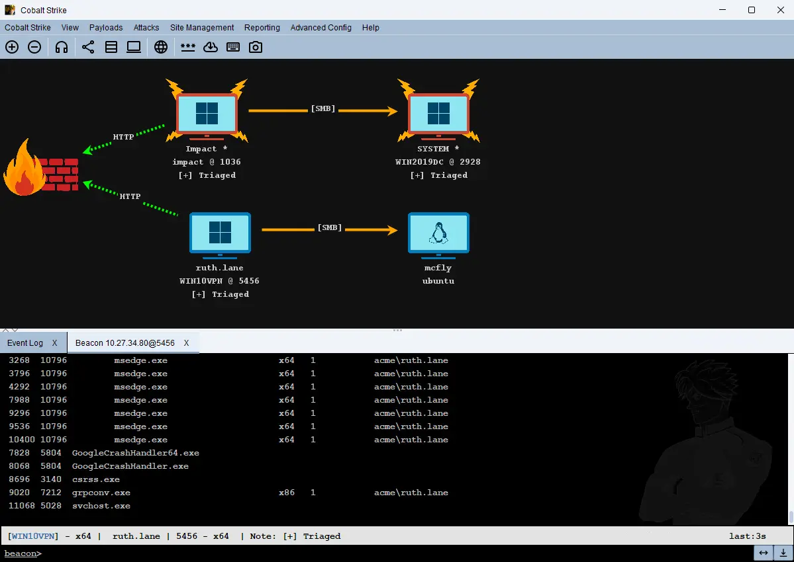

## Brute Ratel C4

Brute Ratel C4 calls itself a customized command-and-control center for red team and adversary simulation. The agent named across the site is Badger. The page leads with HTTPS, DNS over HTTPS, and external channels over sites such as Slack, Discord, and Microsoft Teams.

> [!NOTE]
> Click below to see more details.

More details

Site: [bruteratel.com](https://bruteratel.com/).

| Category | In the project's words | Source |
| --- | --- | --- |
| DNS over HTTPS | A named channel, presented alongside default HTTPS, including switching HTTPS profiles on the fly. | `Site` |
| External C2 | SMB and TCP Badgers, plus custom external channels over sites such as Slack, Discord, and Microsoft Teams. | `Site` |
| Pivoting | SMB, TCP, WMI, WinRM, and managing remote services over RPC. | `Site` |
| Indirect syscalls | A named section. The page also says the operator can switch between WinAPI, NTAPI, and syscalls. | `Site` |
| EDR hook visibility | A built-in debugger section for detecting EDR userland hooks. | `Site` |
| Evasion | A page section titled "Various Out-Of-Box Evasion Capabilities," with its own support table. | `Site` |
| Modules | In-memory execution of C#, BOFs, PowerShell scripts, or reflective DLLs, automated with Click Script. | `Site` |
| MITRE graph | An integrated MITRE graph for built-in commands. | `Site` |
| LDAP | Ldap Sentinel, described as a GUI for LDAP queries against a domain or a forest. | `Site` |
| Adversary simulation | Used in the page title and in the MITRE-graph section. | `Site` |

 

  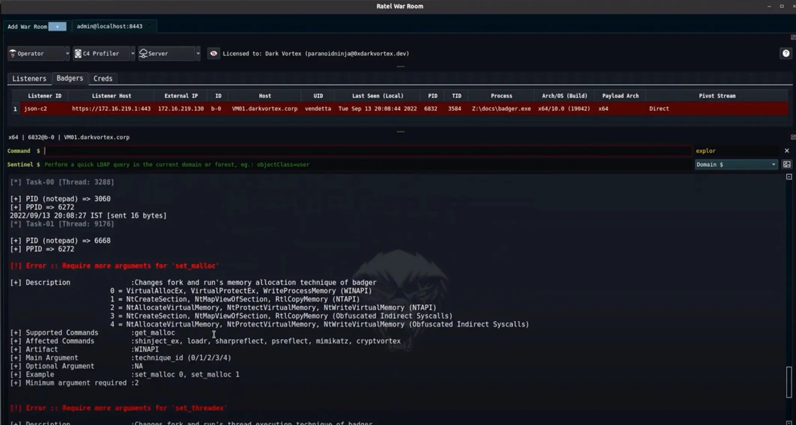

---

# Comparison

A general comparison of the main characteristics of C2 tools.

| | Year | Paid | Implant OS | Indirect syscall | Stack spoofing | Sleep mask | AMSI / ETW | Armory |
| --- | --- | --- | --- | --- | --- | --- | --- | --- |
| NukeRat | 2026 | No | Windows, Linux, macOS | ✅ | ✅ | ✅ | ✅ | 550+ (BOFs and .NET assemblies)|
| Sliver | 2019 | No | Windows, Linux, macOS | ❌ | ❌ | ❌ | ❌ | 22 aliases, 157 extensions |
| Havoc | 2022 | No | Windows | ✅ | ✅ | ✅ | ✅ | BOF sets + InvokeAssembly |
| Mythic | 2018 | No | Per agent | ❌ | ❌ | ❌ | ❌ | External |
| AdaptixC2 | 2024 | No | Windows, Linux, macOS | ❌ | ❌ | ❌ | ❌ | 10 BOF groups |
| Empire | 2015 | No | Windows, Linux, macOS | ❌ | ❌ | ❌ | ❌ | 400+ |
| Merlin | 2017 | No | All OS | ❌ | ❌ | ❌ | ❌ | ❌ |
| Caldera | 2017 | No | Windows, Linux, macOS | ❌ | ❌ | ❌ | ❌ | ❌ |
| Cobalt Strike | 2012 | Yes | Windows | ✅ | ✅ | ✅ | ❌ | Arsenal Kit |
| Brute Ratel C4 | 2020 | Yes | Windows | ✅ | ✅ | ✅ | ✅ | ❌ |